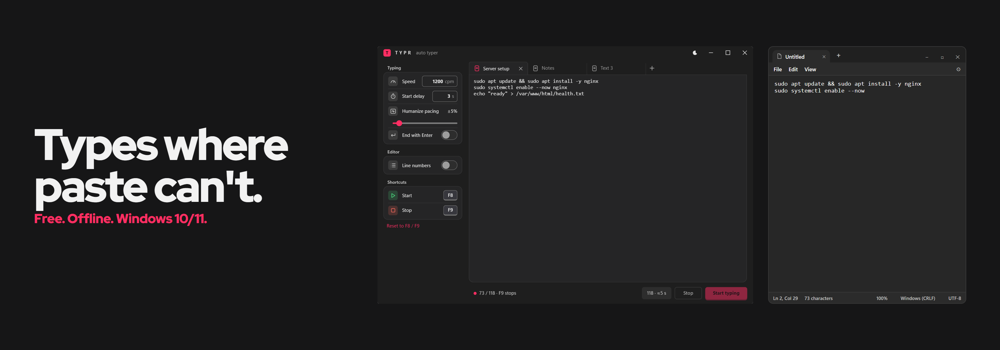

# TYPR

<p align="center">
  
</p>

<p align="center">
  <strong>Free, offline auto typer for Windows.</strong><br>
  Types your saved text into the focused window, for places where paste doesn't work.
</p>

<p align="center">
  <a href="https://github.com/ITMERowe/TYPR/releases/latest"><strong>Download TYPR</strong></a>
  ·
  <a href="https://github.com/ITMERowe/TYPR/issues">Report a problem</a>
</p>

<p align="center">
  
  
  
</p>

## What it does

TYPR sends text as real keystrokes to the app in front. Use it for remote desktops, virtual machines, consoles and web forms that block paste.

- **Types anything:** multiline and Unicode text, at a speed you set, with an optional start delay and human-like pacing.
- **Saved texts in tabs:** add, rename, delete and drag to reorder. Only the open tab is typed.
- **Global shortcuts:** start with **F8** and stop with **F9**, or set your own.
- **Safe stops:** typing stops if the target window loses focus, and **Stop** always works.
- **Light and dark themes:** follows Windows until you pick one. Optional line numbers, and the window reopens at the size you left it.
- **Free and private:** no account, ads, telemetry or network access.

> TYPR types into whichever window has focus. Check the target before you start, and follow that app's rules.

## Install

Download one file from [the latest release](https://github.com/ITMERowe/TYPR/releases/latest):

| File | Use it when |
|---|---|
| `TYPR-Portable-win-x64.exe` | You want one exe to run from anywhere. Nothing is installed. |
| `TYPR-Setup-<version>-win-x64.exe` | You want a Start menu entry and an uninstaller. No admin rights needed. |

Both include .NET, so you don't install anything else. The files aren't code-signed yet: on first run, Windows SmartScreen may say "Windows protected your PC". Choose **More info**, then **Run anyway**.

## Use

1. Paste or write your text in the editor.
2. Set **Speed** and **Start delay** in the sidebar.
3. Press **Start typing** or **F8**.
4. Click into the target window before the countdown ends.
5. Press **Stop** or **F9** to stop early.

**Tips**

- Remote desktops and VMs: start around **600–1,200 characters per minute**. Lower it if characters go missing.
- Tabs are typed as the Tab key. Use spaces if the target app moves focus on Tab.
- TYPR can't type into an app running as administrator unless TYPR runs as administrator too. It tells you when that's the case.
- Click a shortcut in **Settings** to change it. **Reset to F8 / F9** puts them back.

**Keyboard**

| Keys | Action |
|---|---|
| F8 / F9 | Start / stop typing (changeable) |
| Ctrl+Tab, Ctrl+Shift+Tab | Next / previous text tab |
| Ctrl+1 … Ctrl+8, Ctrl+9 | Jump to a tab, or to the last one |
| Ctrl+B | Show settings when the window is narrow |
| Ctrl+Shift+L | Show or hide line numbers |

## Privacy

TYPR works fully offline. It has no telemetry, analytics, auto-updater or background service, and it doesn't use the clipboard: it types through the Windows `SendInput` API.

Your texts, shortcuts, theme and window size are saved on your PC only, in plain JSON:

```text
%LOCALAPPDATA%\TYPR Kimi\settings.json
```

Uninstalling keeps this folder. Delete it to remove your saved texts. Details, including the backup copies TYPR keeps next to that file: [privacy policy](PRIVACY.md).

## Build from source

Needs Windows and the [.NET 8 SDK](https://dotnet.microsoft.com/download/dotnet/8.0). In PowerShell, from the repository folder:

```powershell
dotnet test tests/TYPR.Tests/TYPR.Tests.csproj   # run the tests
.\publish.ps1                                     # build publish\win-x64\TYPR.exe
.\publish.ps1 -Version 1.2.3                      # same, with a version number
```

The result is one self-contained `TYPR.exe`. Its build settings live in `Properties/PublishProfiles/win-x64.pubxml`, shared by `publish.ps1` and both GitHub workflows.

## Releases

1. In `CHANGELOG.md`, add a `## X.Y.Z (date)` section with Highlights first.
2. Push a `vX.Y.Z` tag.

The release workflow runs the tests, builds the portable exe and the installer, and publishes a GitHub Release with that changelog section as its notes. Every push to `main` also runs the tests and uploads a test build as a workflow artifact.

## Contributing

Bug reports and practical feature requests are welcome. Please include your Windows version, display scaling, the app you typed into, the steps, and what you expected. See [CONTRIBUTING.md](CONTRIBUTING.md) for setup and checks. Report security problems privately: [SECURITY.md](SECURITY.md).

## License

[MIT](LICENSE). Use TYPR only on systems and apps you're allowed to use. Some apps don't accept simulated keyboard input.
